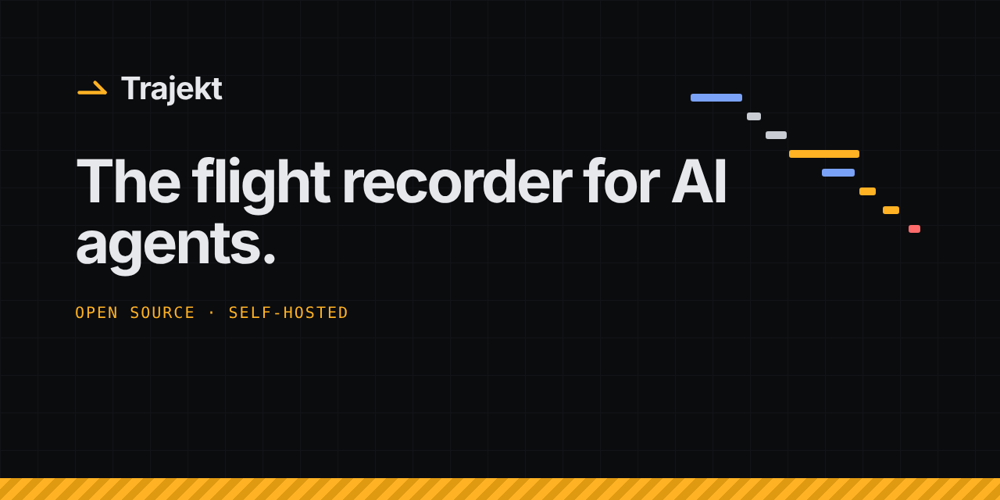
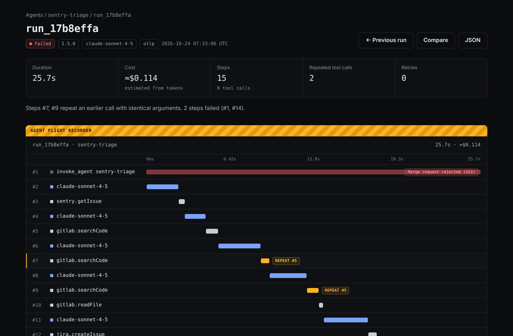

<p align="center">
  
</p>

<p align="center"><strong>English</strong> · <a href="README.fr.md">Français</a></p>

<p align="center">
  <a href="https://www.npmjs.com/package/@trajekt-ai/core"></a>
  <a href="#license"></a>
  <a href="#1-start-trajekt"></a>
  <a href="#record-a-run-with-opentelemetry"></a>
</p>

**Trajekt records every run of your AI agent — each step, the model's reasoning, tool calls with their arguments and results, tokens, latency and cost — and lets you replay the trajectory step by step. Built for the moment an agent goes off the rails in production.**

> **Try it without installing anything:** the [live demo](https://trajekt-demo.vercel.app) replays two weeks of simulated traffic from two agents, one of which regressed after a release. Its read-only MCP endpoint is open too: `claude mcp add --transport http trajekt https://trajekt-demo.vercel.app/api/mcp`.

<p align="center">
  <a href="https://trajekt-demo.vercel.app"><strong>Live demo</strong></a> ·
  <a href="#quickstart">Quickstart</a> ·
  <a href="https://trajekt-eight.vercel.app/docs/">Docs</a> ·
  <a href="DOCKER.md">Self-hosting</a> ·
  <a href="#contributing">Contributing</a>
</p>

<p align="center">
  
</p>

## Why Trajekt

Logs tell you what an agent *said*. Trajekt shows you what it *did*.

- **Replay any run** — every step on a timeline, with the prompt, the model's output, the exact tool arguments and what each tool returned.
- **See where it went wrong** — repeated tool calls (same tool, same arguments), retries after a failure and failed steps are flagged on the timeline.
- **Know what each step cost** — tokens, latency and cost per step and per run. Cost comes from the trace when the source provides it, and is otherwise estimated from tokens (and labelled as such).
- **Compare versions** — every run carries an app version, an agent version, a prompt version and a model. Compare any two values of any of them: prompt `v7` against `v8`, app `3.1.0` against `3.2.0`, your current model against a cheaper one.
- **Track quality, not only cost** — attach scores to runs (correct or not, an LLM judge, a thumbs up), in the trace or after the fact. A version that is cheaper but wrong shows up as a regression.
- **Catch regressions** — Trajekt compares each new agent, prompt or app version with the previous one (and the last 24 h with the 7 days before) on quality scores, failure rate, cost, duration, steps, tokens, loops and tool paths — with statistical tests corrected for the number of metrics — and can post new regressions to Slack.
- **Plug in what you already have** — OTLP over HTTP (JSON or protobuf), the GenAI conventions, Vercel AI SDK, OpenInference (LangChain, LlamaIndex, CrewAI), OpenLLMetry, and a Langfuse importer.

## Quickstart

### 1. Start Trajekt

```bash
git clone https://github.com/LeoLR/trajekt.git
cd trajekt
cp .env.example .env          # set DASHBOARD_PASSWORD and DASHBOARD_SESSION_SECRET
docker compose up -d --build
```

The dashboard and the ingestion endpoint both listen on **http://localhost:3000**. Create a project to get an API key (shown once):

```bash
docker compose exec dashboard pnpm create-project my-project
# optional: two weeks of simulated runs, including a regression, to explore the dashboard
docker compose exec dashboard pnpm seed
```

### 2. Install the SDK

Recording uses plain OpenTelemetry — there is no proprietary SDK in your agent:

```bash
npm i @opentelemetry/sdk-node @opentelemetry/exporter-trace-otlp-http
```

`@trajekt-ai/core` is the library the server uses to read traces. Install it only if you want to read or score traces in your own code or tests:

```bash
npm i @trajekt-ai/core
```

### 3. Record a run

#### Record a run with OpenTelemetry

```ts
// instrumentation.ts
import { NodeSDK } from '@opentelemetry/sdk-node';
import { OTLPTraceExporter } from '@opentelemetry/exporter-trace-otlp-http';

new NodeSDK({
  serviceName: 'sentry-triage',          // becomes the agent name
  traceExporter: new OTLPTraceExporter({
    url: 'http://localhost:3000/v1/traces',
    headers: { Authorization: `Bearer ${process.env.TRAJEKT_API_KEY}` },
  }),
}).start();
```

Or with environment variables only:

```bash
OTEL_SERVICE_NAME=sentry-triage
OTEL_EXPORTER_OTLP_ENDPOINT=http://localhost:3000
OTEL_EXPORTER_OTLP_PROTOCOL=http/json
OTEL_EXPORTER_OTLP_HEADERS="Authorization=Bearer tk_live_..."
```

With the Vercel AI SDK, turn telemetry on for each call:

```ts
await generateText({
  model, prompt, tools,
  experimental_telemetry: { isEnabled: true, functionId: 'sentry-triage' },
});
```

Trajekt recognises spans that follow the OpenTelemetry GenAI semantic conventions (`gen_ai.*`) and the Vercel AI SDK telemetry spans (`ai.*`). Set `service.version` for the app version, and `trajekt.agent.version` / `trajekt.prompt.version` when the agent or its prompt change on their own. An LLM step is titled by its model; set `trajekt.step.name` on its span to name it instead (an agent phase such as `PLAN` or `DEVELOP#2`):

```bash
OTEL_RESOURCE_ATTRIBUTES=service.version=3.2.0,trajekt.agent.version=1.5.0,trajekt.prompt.version=v8
```

#### Send a trace file

A Langfuse trace export, a Vercel AI SDK `generateText` result or an OTLP/JSON file can be posted as-is (examples of each in [`docs/assets/samples`](docs/assets/samples)):

```bash
curl -X POST http://localhost:3000/v1/traces \
  -H "Authorization: Bearer tk_live_..." \
  -H "Content-Type: application/json" \
  -H "X-Trajekt-Agent: support-bot" \
  --data @trace.json
```

#### Read a trace in code

```ts
import { normalize, computeMetrics, annotateSteps } from '@trajekt-ai/core';

const run = normalize(trace);            // Langfuse export, OTLP/JSON or AI SDK result
const metrics = computeMetrics(run);     // status, durationMs, costUsd, redundantToolCalls, retryCount, pathSignature…
const flags = annotateSteps(run);        // per step: error, retry attempt, "repeats step #n"
```

## Test your agent before it ships

Replay a fixed set of scenarios — mocked tools and data — on every change, and let Trajekt tell you whether the new version is worse.

- **Assert on a run** in any test runner:

  ```ts
  import { normalize, assertTrajectory } from '@trajekt-ai/core';

  assertTrajectory(normalize(trace), {
    status: 'ok',
    order: ['sentry.getIssue', 'gitlab.readFile', 'jira.createIssue'],
    calledWith: [{ tool: 'jira.createIssue', args: { project: 'PAY' } }],
    maxRepeatedToolCalls: 0,
    maxCostUsd: 0.08,
  });
  ```

- **Compare eval suites.** Tag eval runs with `trajekt.scenario` and the version under test, and give them a quality score (`trajekt.score.correct`, or `scoreTrajectory()` from your assertions). Trajekt keeps them out of production metrics and compares each scenario with itself across two versions — a paired test that catches a regression with a dozen scenarios — then says `pass` or `fail`, which scenarios got worse, and links to a step-by-step diff.
- **Gate your pull requests.** The [GitHub Action](actions/eval-suite) compares the PR head with its base, comments the result on the pull request — which scenarios got worse, with a link to their diff — and fails the job on a regression:

  ```yaml
  - uses: LeoLR/Trajekt/actions/eval-suite@main
    with:
      url: ${{ vars.TRAJEKT_URL }}
      read-key: ${{ secrets.TRAJEKT_READ_KEY }}
      agent: sentry-triage
      baseline: ${{ github.event.pull_request.base.sha }}
      candidate: ${{ github.event.pull_request.head.sha }}
  ```

  Other CIs call `GET /api/agents/:name/evals`; without a server, use `compareScenarios()` from `@trajekt-ai/core`. A runnable example is in [`examples/eval-suite`](examples/eval-suite).

See [Testing your agent](https://trajekt-eight.vercel.app/docs/#testing) in the docs, and the eval suite of the [live demo](https://trajekt-demo.vercel.app/agents/sentry-triage/evals).

## Run it for a team

Several projects per instance, each with its own API keys (`/projects`). Customer data is masked before storage: secrets by default, emails, IBANs, cards, phones and your own patterns on demand. Retention (`TRAJEKT_RETENTION_DAYS`), ingestion rate and size limits, and an option to drop raw payloads are in the [configuration](https://trajekt-eight.vercel.app/docs/#configuration).

## Works with

| Source | How |
|---|---|
| OpenTelemetry | Any OTLP/HTTP exporter, **JSON or protobuf**, gzip accepted. gRPC is not supported. |
| OpenTelemetry GenAI semantic conventions | `gen_ai.operation.name`, `gen_ai.request.model`, `gen_ai.usage.*`, `gen_ai.tool.*`, `gen_ai.agent.name`, `gen_ai.input/output.messages` |
| Vercel AI SDK | `experimental_telemetry` spans through an OTel exporter, or a `generateText` result posted to `/v1/traces` |
| OpenInference / OpenLLMetry | LangChain, LlamaIndex, CrewAI… through their OTLP exporter: models, tokens, tools and their arguments |
| Langfuse | `pnpm import-langfuse --since 7d` pulls traces and scores from a Langfuse project (re-runnable, no duplicates), or post a trace export to `/v1/traces` |
| Hand-written agents | `traceRun` / `traceTool` from `@trajekt-ai/core` with any OpenTelemetry tracer |

## Repository layout

```
packages/
  core/          @trajekt-ai/core — normalize(), merge, metrics, regression tests, run diff,
                 eval suite comparison, trajectory assertions
apps/
  dashboard/     Next.js — ingestion (POST /v1/traces), API and dashboard
    migrations/    SQL schema (one Postgres, nothing else)
    src/server/    ingestion, queries, alerts, simulated traffic
    src/views/     dashboard pages
    test/          tests against a real Postgres
  site/          Landing page and docs (Vite + React, prerendered)
actions/
  eval-suite/    GitHub Action — compare eval suites on pull requests
examples/
  eval-suite/    a toy agent, mocked scenarios, behaviour tests and suite comparison
docs/            API contract, architecture notes, assets
docker-compose.yml   Postgres + dashboard
```

## Contributing

```bash
pnpm install
pnpm --filter @trajekt-ai/core build
pnpm test                       # core unit tests + dashboard tests (needs a Postgres, see below)
pnpm --filter dashboard dev     # http://localhost:3000
pnpm --filter site dev          # landing page on http://localhost:5173
```

The dashboard tests create and drop a throwaway database on a local Postgres (`TEST_PG_HOST`, `TEST_PG_PORT`, `TEST_PG_USER`; defaults `127.0.0.1:54329`, user `postgres`, trust auth). Issues and pull requests are welcome.

## License

MIT — see the `license` field in [`packages/core/package.json`](packages/core/package.json).
